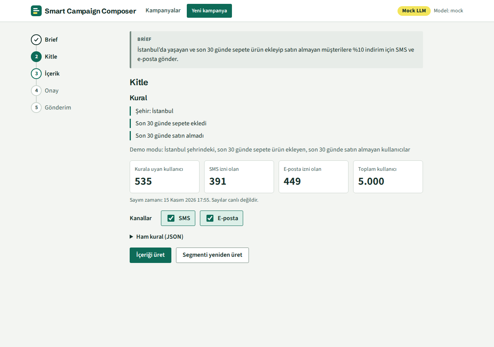
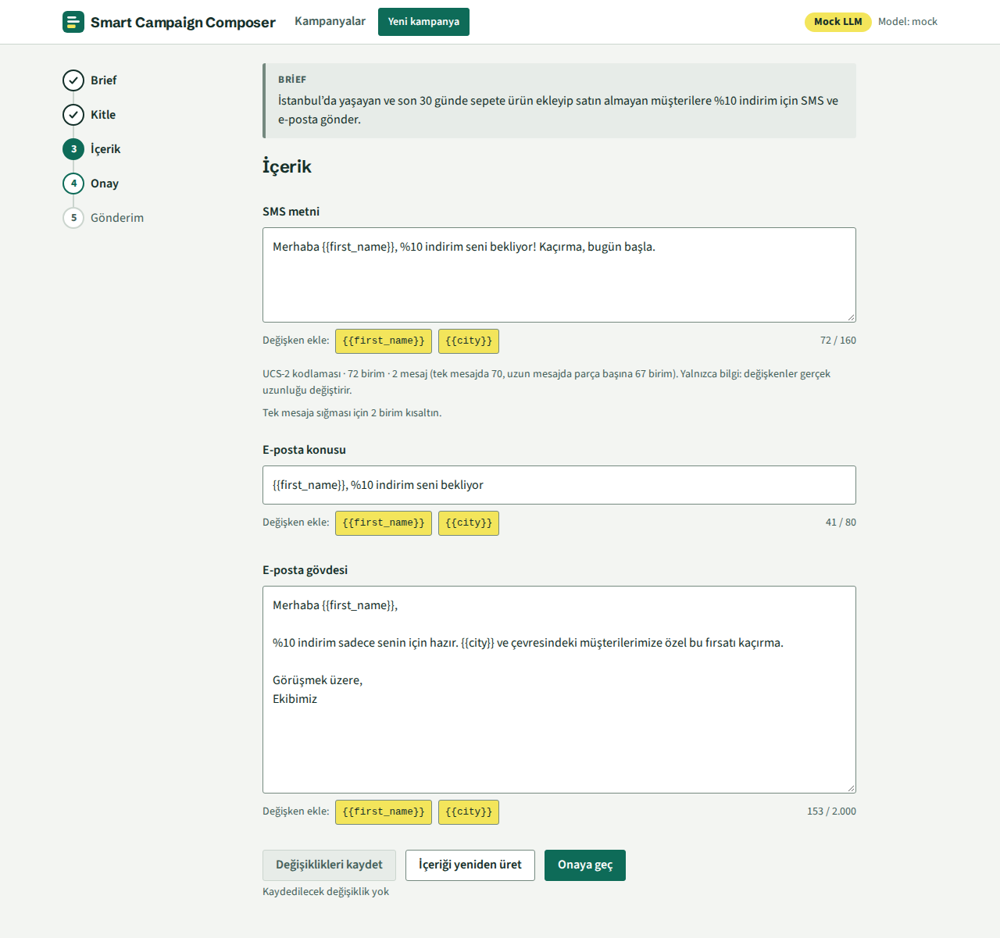
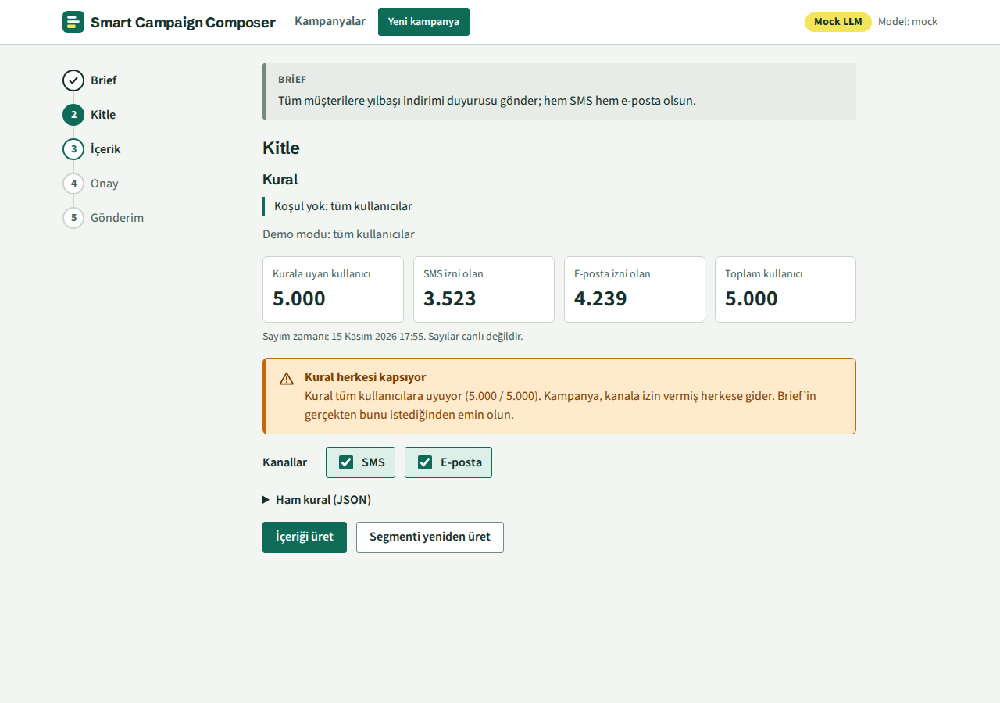
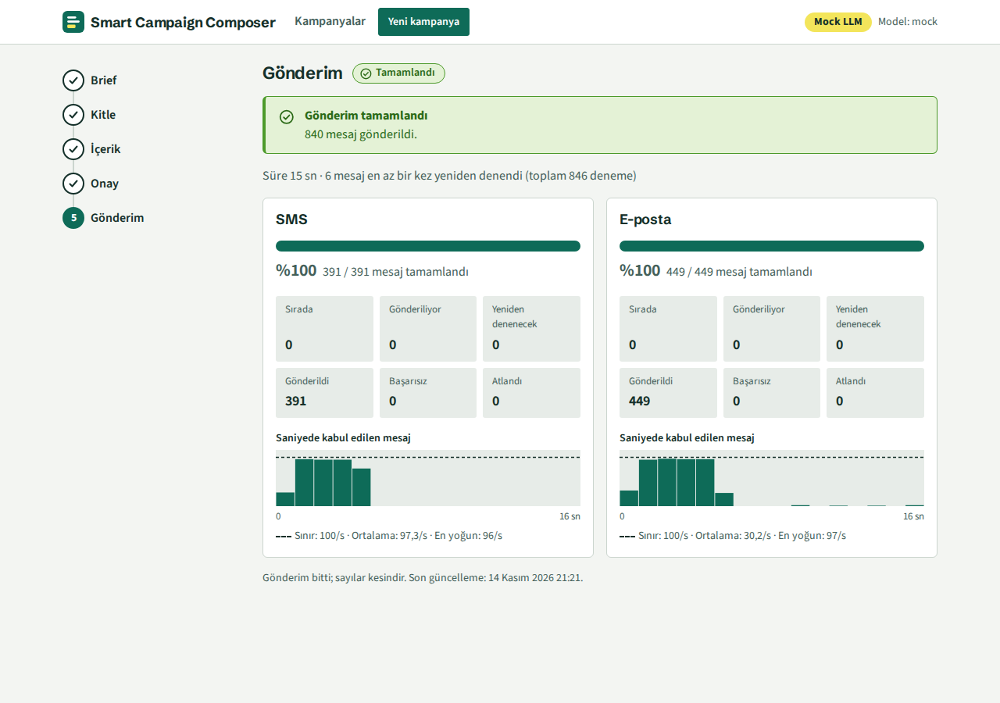

# Smart Campaign Composer

A marketer writes a campaign brief in plain language (Turkish in the examples). Claude turns it into a **segment rule** and
**SMS / e-mail text**; the marketer sees how many people the rule reaches, edits the text, and **approves**; the approved campaign
goes through a Postgres-backed queue to a **mock provider** (100 messages per second per channel, retries, idempotency) while a
live dashboard shows what is happening. The interface is in Turkish; code, comments and documents are in English.

| Brief and audience | Written content |
|---|---|
|  |  |
| **A rule that reaches everyone needs an acknowledgement** | **A finished delivery, with retries** |
|  |  |

More pictures (approval, provider outage, campaign list) are in [`docs/screenshots/`](docs/screenshots/).

## Quick start

Needs Docker (Compose v2). Nothing else is installed on the host.

```sh
docker compose up
```

Then open **http://127.0.0.1:3000** (the web app; it forwards `/api` to the API, which is also on `http://127.0.0.1:8080`).
The first start builds the images. Postgres and the mock provider are not published outside the Compose network.

**Without a key it runs in mock mode.** No API key is needed and nothing is sent to Anthropic: a small deterministic,
keyword-based "demo model" answers instead. The header of the app shows a yellow **Mock LLM** badge and `Model: mock`. Try a brief
like *"İstanbul'daki müşterilere SMS ile yeni koleksiyonu tanıtalım"*. A brief the demo model does not understand comes back as
`unsupported_criteria` and a warning, which is also what the real model does for something the rule language cannot say.

**With the real model:** copy `.env.example` to `.env`, write your key after `ANTHROPIC_API_KEY=` in the `.env` file, and run
`docker compose up` again. The `.env` file is git-ignored; `.env.example` stays empty. Real calls cost money.

| `LLM_MODE` | Behaviour |
|---|---|
| `auto` (default) | the real model when a key is set, the mock otherwise |
| `anthropic` | the real model; the API refuses to start without a key |
| `mock` | never calls the real API, even if a key is present (use this to be sure nothing is spent) |

`LLM_MODE=mock docker compose up` (Git Bash) or `$env:LLM_MODE='mock'; docker compose up` (PowerShell). The badge in the header
always shows the mode that is really in use. Every other setting has a default; the ones you may want are listed in `.env.example`.

## How it works

```
brief (text)
   │  Claude, structured output, one request per task
   ▼
segment rule  ── JSON, AND-of-OR (CNF): a list of conditions ANDed together,
   │             each one a single condition or an OR group; validated against
   │             field / operator / value whitelists, compiled to parameterized SQL
   ▼
audience: total / SMS-consenting / e-mail-consenting counts + warnings
   │  (matches everyone, criteria the rule cannot express, nobody reachable)
   ▼
content: SMS, e-mail subject and body, streamed (SSE) and validated
   │  (SMS ≤ 160, subject ≤ 80, only {{first_name}} and {{city}}; a bad answer is repaired, twice at most)
   ▼
human approval  ── one transaction freezes rule, text and recipient list (a snapshot)
   ▼
deliveries table (the queue, FOR UPDATE SKIP LOCKED)
   ▼
worker: ≤100 msg/s per channel, retry with backoff and Retry-After, circuit breaker, leases
   ▼
mock provider (idempotency key per delivery; fails, throttles and answers late on purpose)
   ▼
dashboard: counts per channel, rate chart against the cap, retries, outages
```

One Go binary (`api`, `worker`, `seed` commands) plus a separate mock provider; Vue 3 + Vite + TypeScript for the web app;
PostgreSQL. Why each part is the way it is: [DECISIONS.md](DECISIONS.md).

## Security

- **Fake users only.** The seed creates 5,000 users with `userNNNNN@example.com` (RFC 2606) and phone numbers `+90000…`
  that no real number can match. Messages go to the **mock provider** only; there is no real SMS or e-mail integration.
- **Local only.** The API (`8080`) and the web app (`3000`) are published on `127.0.0.1`; the database and the provider are not
  published at all. There is no authentication, so the stack is not meant to be exposed.
- **Model output is untrusted.** It is checked against a JSON schema, then by Go validators (whitelisted fields, operators and
  values; length and variable rules for the text), and reaches the database only as a **parameterized** SQL fragment built from a
  whitelist of column names. The model never writes SQL. Consent is read again when each message is claimed.
- **Prompt injection.** The brief is passed to the model as data inside an escaped JSON string, and the prompt says not to follow
  it. That is only a courtesy; what makes a hostile brief harmless is the validation above. The worst case is a valid rule that
  the marketer sees, in words and with counts, before approving. The golden set has an injection brief (`enjeksiyon`).
- **The key** lives only in `.env`. Hooks and a secret scanner guard the repository ([How it was built](#how-it-was-built)).

## Commands

Docker and `make` are enough; Go and npm run in pinned containers, never on the host.

| Command | What it does | Time |
|---|---|---|
| `make test` | gofmt, `go vet`, `go test -race` with PostgreSQL integration tests, hook and script tests, the web checks (`npm audit`, `vue-tsc`, Vitest). No API key. | about 160 s (161 s measured; the slowest package, the worker, takes about 90 s) |
| `make e2e` | Playwright browser tests against the real stack with the mock model, in a project of its own that is removed afterwards. `SCREENSHOTS=1` rewrites `docs/screenshots/`. | about 2 minutes (116 to 125 s in three runs) |
| `make soak` | 5,000 messages through the real containers with a chaos provider; fails on a double send, a broken 100/s cap or an early retry. | about 4 minutes (236 s measured, 3 min 39 s of it the run itself; the default backoff starts at 15 s) |
| `make eval LLM_MODE=anthropic` | the golden set (`eval/golden.json`, 16 Turkish briefs) against the **real** model, scored by deterministic checks, no model as judge. **Costs money** (about $0.25 on the default model); it refuses to start without `LLM_MODE=anthropic` and a key, and stops at `EVAL_MAX_USD` (default `1.00`). | about 100 s |
| `make eval EVAL_ARGS="-mock"` | the same set against the demo model (16 of 16 pass): free, writes no result file. | about 75 s (74 s measured; the demo model streams slowly on purpose) |

`make test` and `make e2e` need no key and spend nothing. Results of earlier real runs are in [`eval/results/`](eval/results/).

The times were measured on a clean clone of this repository (no dotenv file, `git clone` into a temporary folder), on a Windows
machine with Docker Desktop, with the images of the third-party containers already pulled and the Docker build cache warm; the
first `docker compose up -d` of that clone took 19 s on a warm build cache, and a first build with empty caches takes longer
(not measured). Expect more on a slower machine.

**CI** (`.github/workflows/ci.yml`, on a push to `main`, on pull requests and by hand) runs `make test`, then `docker compose up`
without a dotenv file (it checks that `/api/config` says `llm_mode: mock`) and `make e2e`. It has no secret and no API key, and
`LLM_MODE=mock` is set in the file. `make soak` and `make eval` are not part of it. On Linux 8 of the 125 hook and script tests are
skipped, in `make test` and in CI alike: 4 tests of the guard hook that use Windows drive paths (`C:\...`, which only mean something on
Windows) and 4 tests of the gofmt hook (the Node image has no `gofmt`; `gofmt` itself is checked in the Go container). The first four run
under `node --test` on Windows, the other four wherever `gofmt` is installed.

## Model choice

The default is **`claude-sonnet-5-5`**. On the golden set (one run per brief, so a smoke result and not a rate) the last full run
passed **16 of 16 briefs for $0.249** with no repair. Against `claude-opus-5-5` on 14 briefs: $0.206 against $0.546, 81 s against
175 s of model time, and the first text of the content arrives after 1.0 s against 6.3 s, which matters because the text is
streamed to the marketer. The deterministic checks cannot judge wording, so the owner read the Turkish texts of both models side
by side before deciding (details and the limits of the comparison in [DECISIONS.md](DECISIONS.md), "The model decision").

Opus is one setting away: `ANTHROPIC_MODEL=claude-opus-5-5` in `.env` (and `EVAL_MODEL=claude-opus-5-5` for `make eval`).

## How it was built

A written plan ([docs/PLAN.md](docs/PLAN.md), in Turkish) came first. The code was then written in a series of Claude Code sessions, all
exported in full to [`ai-sessions/`](ai-sessions/) (the list, and the masking rules, are in [`ai-sessions/README.md`](ai-sessions/README.md)).
The sessions ran in bypass-permissions mode, balanced by a `PreToolUse` guard hook (no reading of `.env`, no environment dumps, no
force push, no `--no-verify`, no deleting outside the project) and a gitleaks pre-commit hook. The golden-set eval, run against the
real API, found and drove several fixes to the prompts and the validation; each is written down in DECISIONS.md.

## Not done, and known limits

- No authentication or multi-tenancy, no real SMS or e-mail provider, no delivery receipts: "sent" means the provider answered 2xx.
- The rule language has two levels (AND of conditions or OR groups, at most 10 each), no `not` node, and cannot express the order
  of events or criteria such as age, gender or birthdays; such criteria are reported as `unsupported_criteria`, never guessed.
- `LLM_MODE=auto` with a blank or misspelled key silently serves the demo model (the badge says so); use `anthropic` to fail instead.
- The eval is one run per brief and does not score wording; Opus was not re-run on the newest prompt.
- Model routing (Sonnet first, one retry on Opus when validation still fails after repair) is not built: the eval showed no gap
  it would close. It is described under future work in DECISIONS.md.
- One worker serves a channel at a time (a database advisory lock); extra workers are standbys.

## Links

[DECISIONS.md](DECISIONS.md) (every decision, with the alternatives) · [docs/PLAN.md](docs/PLAN.md) (the plan, in Turkish) ·
[ai-sessions/](ai-sessions/) (the Claude Code sessions) · [docs/ai-tooling.md](docs/ai-tooling.md) (installed tools and how they were checked) ·
[design-system/MASTER.md](design-system/MASTER.md) (design notes)

## Türkçe özet

**Smart Campaign Composer**: pazarlamacı brief'i doğal dille yazar; Claude bunu bir segment kuralına ve SMS / e-posta metnine
çevirir; pazarlamacı kitle sayılarını görür, metni düzenler ve onaylar; onaylanan kampanya Postgres tabanlı bir kuyruk üzerinden
sahte (mock) bir sağlayıcıya gönderilir, canlı panel durumu gösterir. Arayüz Türkçedir.

- **Çalıştırma:** `docker compose up`, sonra http://127.0.0.1:3000. API anahtarı yoksa uygulama mock modunda açılır (başlıkta sarı
  "Mock LLM" rozeti). Gerçek model için `.env.example` dosyasını `.env` olarak kopyalayıp `ANTHROPIC_API_KEY=` satırına anahtarı yazın.
  Hiçbir şey harcanmasın istenirse `LLM_MODE=mock`.
- **Güvenlik:** yalnızca sahte kullanıcılar (`example.com`, `+90000…`) ve mock sağlayıcı; portlar yalnızca `127.0.0.1`'e bağlı; model
  çıktısı şema ve beyaz listelerle doğrulanır, veritabanına yalnızca parametreli SQL olarak ulaşır.
- **Testler:** `make test` (anahtarsız), `make e2e` (tarayıcı), `make soak` (5.000 mesaj), `make eval LLM_MODE=anthropic` (gerçek API,
  yaklaşık 0,25 $, `EVAL_MAX_USD` ile sınırlı).
- **Varsayılan model** `claude-sonnet-5-5`; Opus için `ANTHROPIC_MODEL=claude-opus-5-5`. Gerekçeler ve bilinen sınırlar
  [DECISIONS.md](DECISIONS.md) içinde; geliştirme oturumları [ai-sessions/](ai-sessions/) altında.
